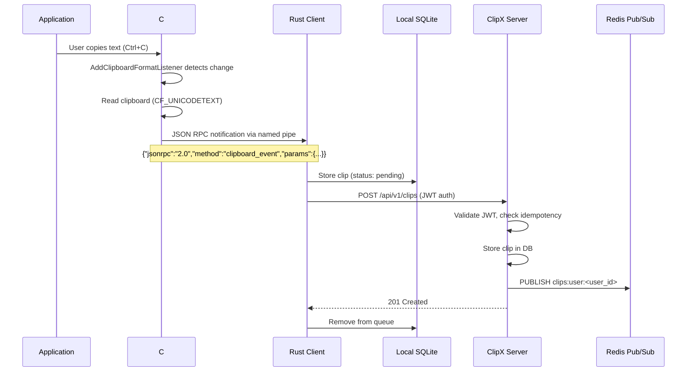
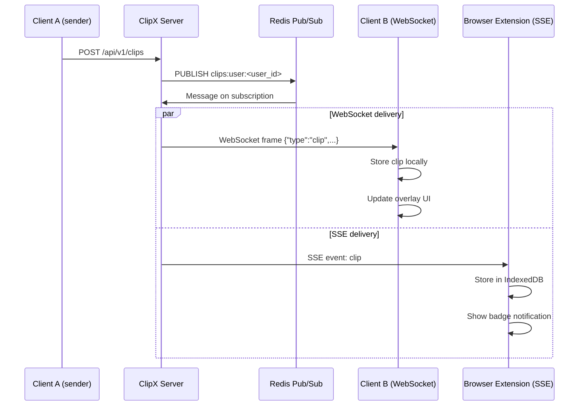
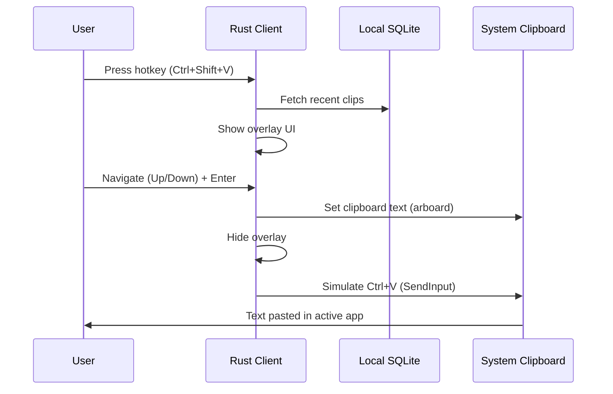
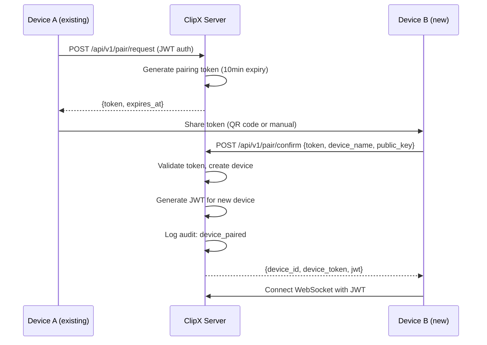
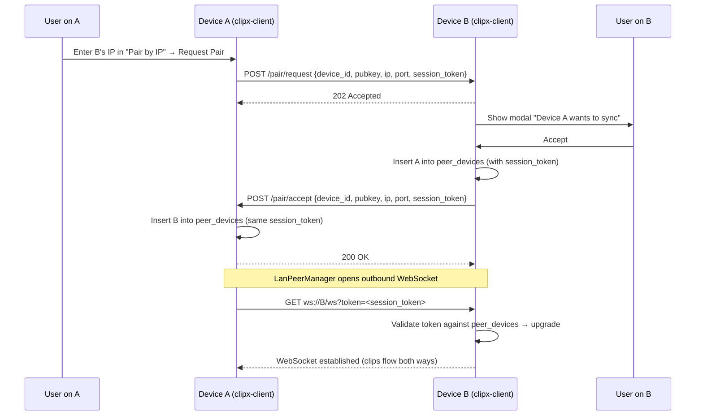
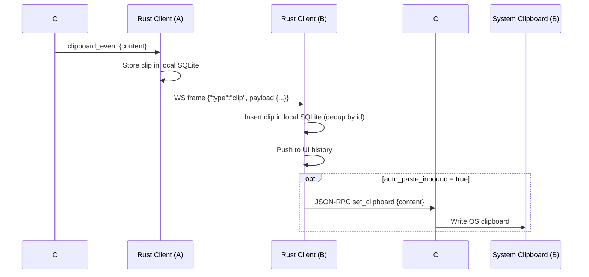
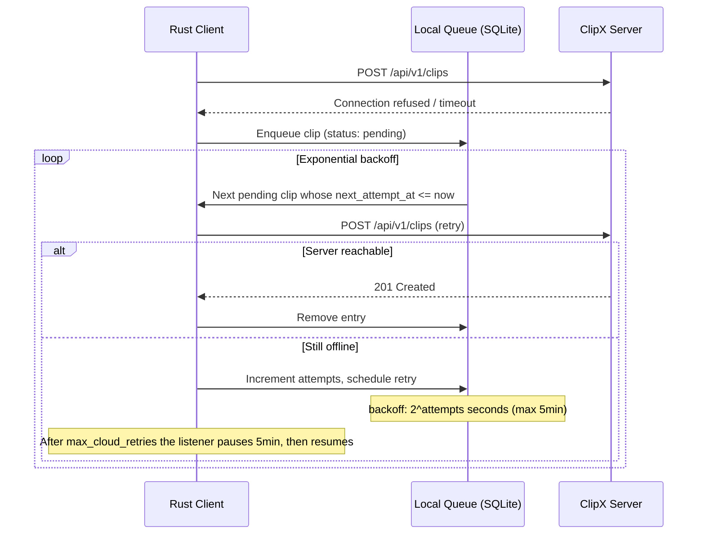
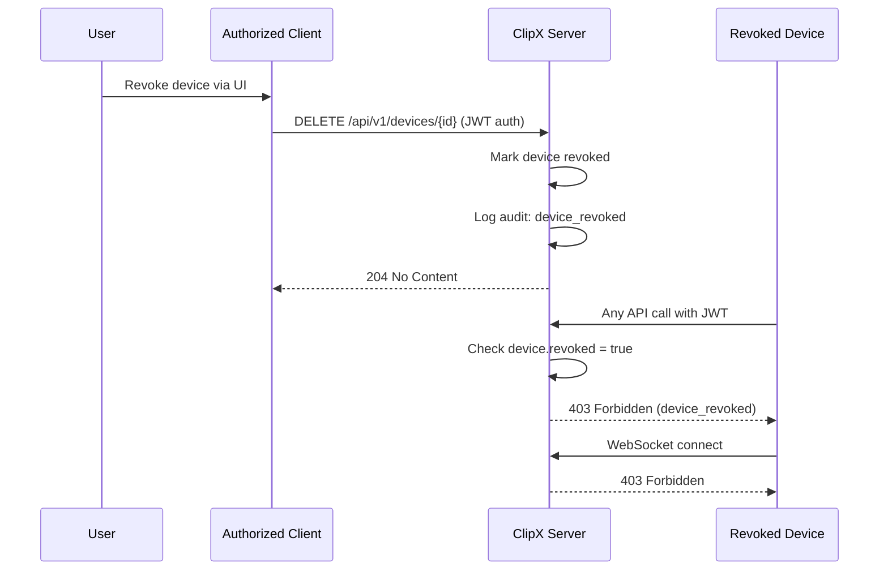

# ClipX Sequence Diagrams

## Copy Flow

## Sync Flow (Real-Time Delivery)

## Paste Flow (Overlay)

## Device Pairing Flow

## LAN Pair Flow (server-independent)

## LAN Clip Sync (after pairing)

## Cloud Offline Queue Flow

Note: LAN sync (above) does not use the offline queue — it broadcasts directly to any connected LAN peer WebSocket regardless of cloud state.

## Device Revocation Flow

